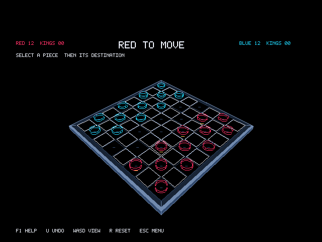

# 3D Checkers 88

Play checkers against the computer or a friend on the same PC. Rotate the board
to a view you like, pick a colour theme and play with some classical AdLib music
in the background. Forced captures, kings, undo and selectable AI difficulty
are included.

## Run

Copy `CHECK88.EXE` to a writable DOS folder and run `CHECK88`. It saves your
settings in `CHECK88.CFG`. The music is built in; no separate player is needed.

Requires DOS 3.3+, a V20/V30 or 80186-compatible CPU, and VGA 640x480 in
16 colours. An 8087 is optional. Keyboard, DOS mouse and gameport joystick
controls are supported. AdLib is optional, with separate music and effects
volume controls.

Use WASD to rotate and tilt the board, R to restore the default view, and F1
for help. A piece with only one legal destination highlights it, then waits
for confirmation. The full controls and settings are in [README.TXT](README.TXT).

## Source and credits

Version 1.2.1. Source and an Open Watcom build script are included; see the
collection's [build instructions](../BUILDING.md) and [test notes](TESTING.TXT).

Game code is MIT licensed, with the Open Watcom runtime covered by
[OWLIC.TXT](OWLIC.TXT). The classical music arrangements retain their original
licenses, including their converted data in the executable. See
[MUSIC/SOURCES.TXT](MUSIC/SOURCES.TXT) for credits, licenses and source files,
and [CREDITS.TXT](CREDITS.TXT) for programming references.
