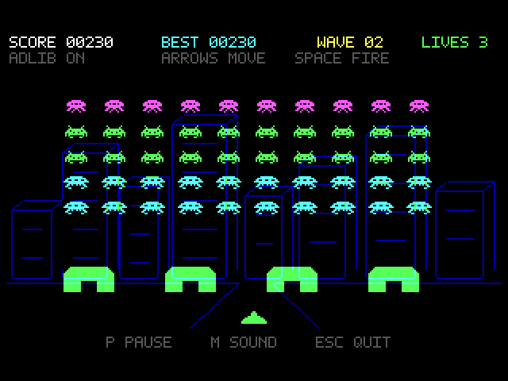

# XT Invaders 2.0

Shoot the aliens before they reach the bottom of the screen. This XT-style
Invaders game has the marching thump, AdLib effects and a new backdrop each
wave. Play with a keyboard or a gameport joystick/gamepad.

*An alien wave over the city backdrop.*

- **Run:** `INVADERS` for 320x200; `INVADERS /V` for 640x480. Both use 16 colours.
- **Joystick/gamepad:** add `/J` to calibrate, or press J at the title.
- **Controls:** arrows and Space, or gameport left/right and button 1. P or
  button 2 pauses; M toggles sound; Escape quits.
- **Hardware:** 8088/8086 or later; EGA/VGA; optional AdLib and standard
  analog-compatible PC gameport. No external assets or audio driver.
- **Full instructions:** [README.TXT](README.TXT).
- **Build:** `sh BUILD.SH` with GNU binutils.

Version 2.0 makes quick taps of the fire button more reliable and movement
smoother. It also adds six backdrops. In VGA mode, the doubled sprites fill a
centred 640x400 playfield on a 640x480 screen. Rendering details are in
[TESTS.TXT](TESTS.TXT).

Tested in QEMU and DOSBox, including an emulated gameport controller. See
[TESTS.TXT](TESTS.TXT) for coverage and hardware-validation limits.
Project-authored material is MIT licensed; see [../LICENSE](../LICENSE) and
[../THIRD_PARTY.md](../THIRD_PARTY.md) for runtime/dependency terms.
