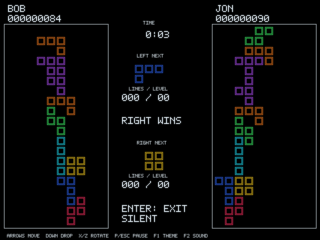

# ИuXTяis Multiplayer 0.6.4

Play Tetris together with both boards on screen. You get the same pieces, so
it's a straight score race. Choose a time limit, or play sudden death: the
first top-out ends the match and the higher score wins. Either player can pause
or resume. Both computers save the result with both players' names and scores.



This is a separate game from [single-player ИuXTяis](../NUXTRIS/). Copy
`NXTNET.EXE` to a writable DOS folder on **both** computers and run `NXTNET`.
Enter your name in the menu, then choose HOST GAME on one computer and JOIN
GAME on the other. The host chooses the match rules. Keyboard and gameport
controls are supported.

## Connect over LAN

Load an Ethernet packet driver on each DOS computer. Set `MTCPCFG` to the full
DOS path of the mTCP configuration file before starting the game. You can put
the command in `AUTOEXEC.BAT` or enter it at the DOS prompt:

```dos
SET MTCPCFG=C:\NET\MTCP.CFG
```

That file must contain `PACKETINT`, `IPADDR` and `NETMASK`; add `GATEWAY` if
the other computer is outside your subnet. `PACKETINT` must match the software
interrupt used to load the packet driver, such as `0x60`. The game reads these
settings itself; an mTCP program does not have to stay open. It uses UDP port
47587.

In CONNECTION, set LINK to LAN. HOST GAME shows the address read from
`MTCPCFG`, with a cyan marker. If the settings cannot be read, it shows
IP ERROR with a red marker. The joining player enters the address shown on
the host.
[LANBOX.SH](LANBOX.SH) starts a DOSBox-X LAN client on the Linux machine used
for development. Its driver path and setup are explained in
[README.TXT](README.TXT). A working packet driver is required on real DOS
hardware and is not included here.

## Connect over serial

In CONNECTION, set LINK to SERIAL and choose each computer's COM port. Set
the same baud rate and flow control on both ends. [DOSBOXX.SH](DOSBOXX.SH)
helps connect DOSBox-X to a USB serial adapter on Linux. The full cable setup
and controls are in [README.TXT](README.TXT).

The game targets a V20/V30 or 80186-compatible CPU, DOS 3.3+, VGA 640x480x16
and 640 KB RAM. AdLib and a standard analog gameport are supported. Your
settings and match history stay in `NXTMULT.CFG` and `NXTMATCH.TXT`; keep those
files when updating.

This is a multiplayer preview. I played a smooth NuXT-to-DOSBox-X LAN match
with version 0.6.1. Version 0.6.4 fixes the blank HOST GAME row in 0.6.3. The match protocol
and gameplay are unchanged. See
[TESTS.TXT](TESTS.TXT) for the checks and remaining hardware-test limits.

Source and an Open Watcom build script are included. The original game and
serial code are MIT licensed. The LAN packet-driver adapter uses code adapted
from Michael B. Brutman's mTCP under GPL-3.0-or-later, so the combined
`NXTNET.EXE` is distributed under GPL-3.0-or-later. See [CREDITS.TXT](CREDITS.TXT),
[UPSTREAM.TXT](UPSTREAM.TXT) and [GPL3.TXT](GPL3.TXT) for details.
