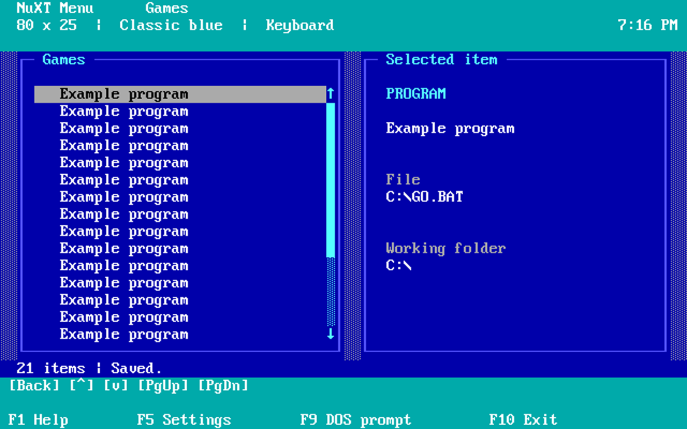
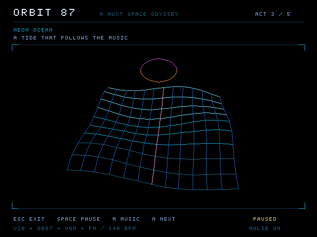
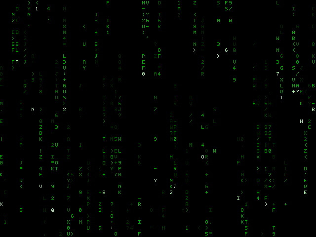
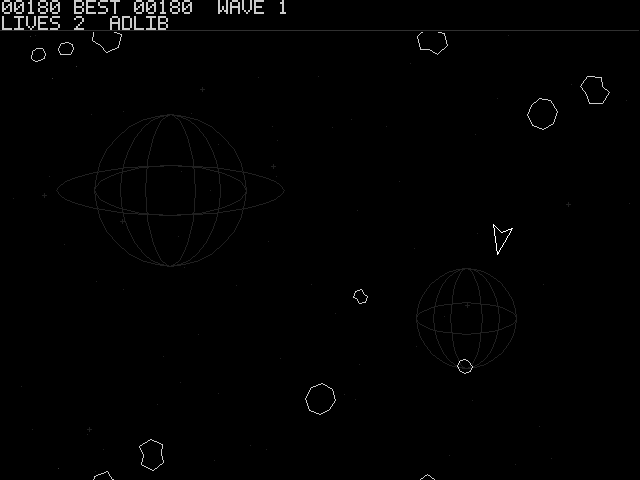
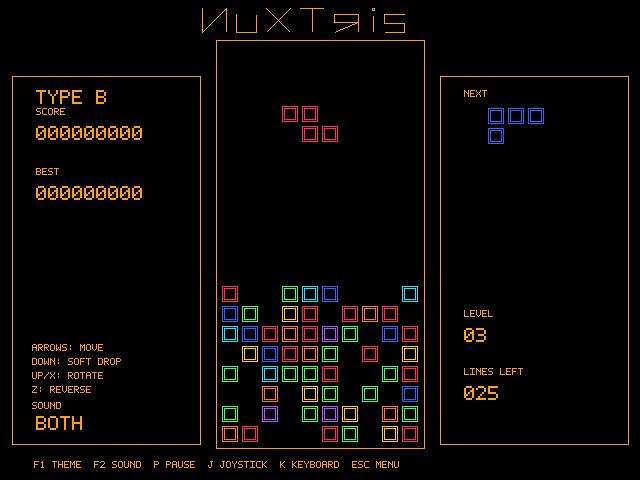
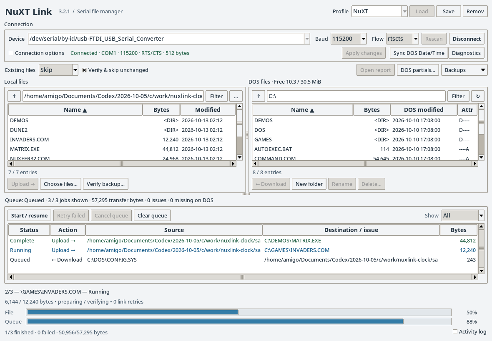
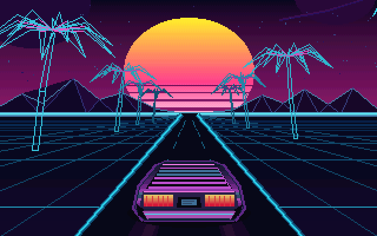
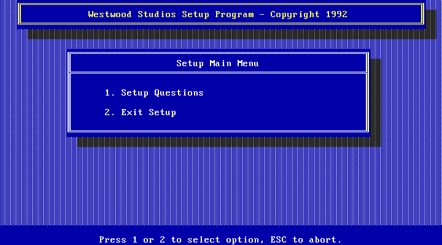
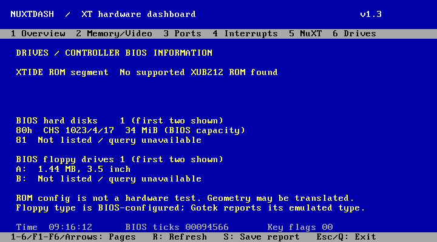

# Screenshots

A look at each project. Click a picture to see it at full size, or the name to open its instructions.

These are saved program captures from development checks. NuXTLink shows sample transfer data; NuXT Dash shows emulated hardware. They illustrate the programs, not performance on the NuXT.

| | |
| --- | --- |
| **[NUXMENU](NUXMENU/)**  DOS launcher with menus and favourites. | **[ORBIT87](ORBIT87/)**  Neon Ocean scene. ORBIT87 and ORBITV20 share the same visuals. |
| **[STARFIELD](STARFIELD/)**  Stars moving towards the viewer. | **[MATRIX](MATRIX/)**  Falling green characters with glow enabled. |
| **[INVADERS](INVADERS/)**  An alien wave over the city backdrop. | **[NUXTROIDS](NUXTROIDS/)**  Asteroids, the player ship and distant planets. |
| **[NUXTRIS](NUXTRIS/)**  Type B play with the amber theme. | **[NUXTLINK](NUXTLINK/)**  Linux client with an example transfer queue and the Sync DOS Date/Time button. |
| **[SUNSET](SUNSET/)**  The demo running at 320x200 in 256 colours. | **[DUNE2FIX](DUNE2FIX/)**  Dune II setup running after the XMS fix. Original game files are required. |
| **[NUXTDASH](NUXTDASH/)**  The Drives page in an emulator. Hardware details will differ on your NuXT. |  |

The Dune II setup screenshot shows Westwood's commercial game and is not covered by this repository's MIT license. See [third-party notes](THIRD_PARTY.md).
