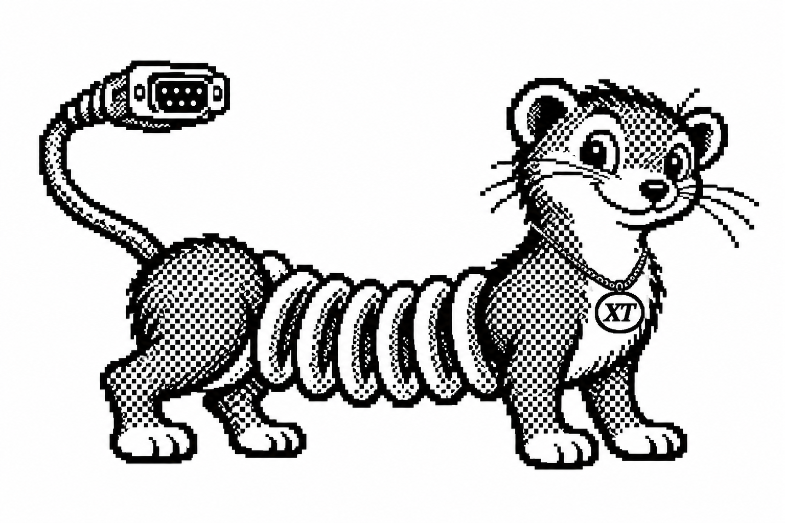
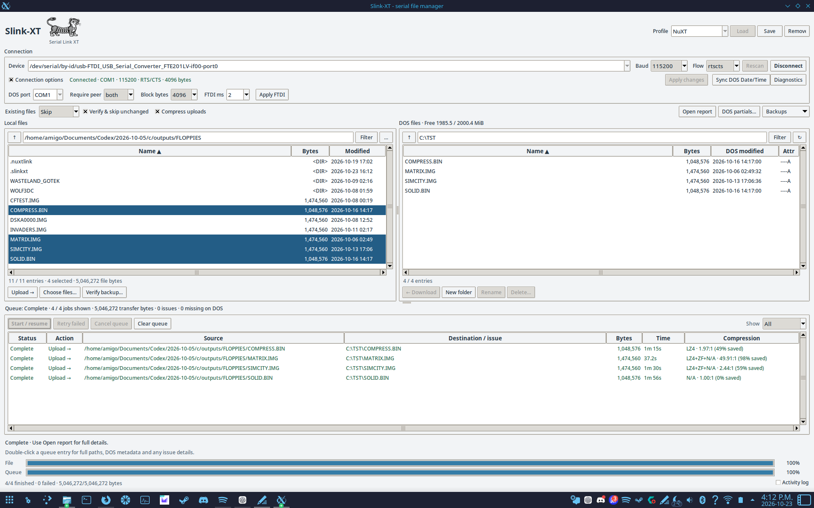
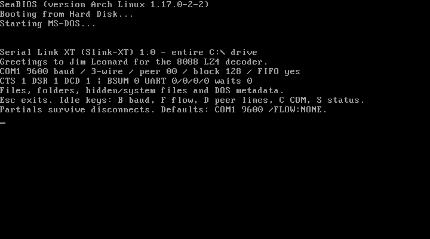

# Slink-XT 1.0



Serial Link XT moves files between Linux and DOS over a serial cable. Its Linux file manager browses both machines, queues transfers, backs up DOS folders, and can set the DOS clock. Interrupted transfers can resume, and each file is checked before it replaces the destination.

SlinkX, the cable-tailed mascot in the Linux header, was supplied by the project owner.

<a href="screenshots/linux.png"></a>

<a href="screenshots/dos.png"></a>

`SLINK.COM` and the Linux client are both version 1.0. They use Slink-XT wire version 1 and must be used together.

## Setup

Copy `SLINK.COM` in binary mode to a DOS folder named `SLINKXT`, for example `C:\SLINKXT\SLINK.COM`. Exit any running server before replacing its executable. Start it from DOS with:

```dos
C:\SLINKXT\SLINK.COM COM1
```

Use the drive and COM port on your machine. The server serves the drive containing its executable. It starts at 9600 baud so the Linux client can find it, then switches to the selected speed. Press Esc to exit.

On Linux, start the matching client with `sh linux/launch.sh`. Choose the USB serial device and connect. The default settings are 115200 baud, RTS/CTS, and 4096-byte blocks; use no flow control for a three-wire cable. Settings start fresh in `~/.config/slinkxt/profiles.json` (or `$XDG_CONFIG_HOME/slinkxt/profiles.json`). Slink-XT does not import or alter NuXTLink profiles.

The Linux client needs Python 3.10 or newer, Tkinter, and a Linux system library for optional LZ4 uploads. The included native helpers are built for x86-64 Linux; on another architecture, build them with a C compiler using `sh linux/build_bsum.sh` and `sh linux/build_codec.sh`. The DOS build script is `dos/BUILD.SH` and requires Open Watcom with `WATCOM` set.

## Transfers

Linux chooses raw, zero-run, heatshrink, or LZ4 for each upload block. At 115200 baud with 4096-byte blocks, it can choose LZ4 over a slightly smaller heatshrink packet because the DOS decoder runs faster. DOS-to-Linux downloads use raw or zero-run blocks to keep work on the DOS CPU light. The queue lists the codecs actually used for each completed file as `LZ4`, `HS`, `ZF`, or `N/A` for raw blocks; a mixed file lists multiple types. Compression can be disabled for uploads; checks remain enabled either way.

Each frame and complete file uses a 16-bit BSUM 1.1-compatible BSD checksum. DOS rereads an uploaded staging file before committing it; Linux rereads a staged download before replacing the destination and records a SHA-256 digest for local verification. BSUM is faster and weaker at detecting corruption than the CRC in NuXTLink 4.1. This is a deliberate choice for this hobby project. For important files, compare hashes on both machines after transfer.

Slink-XT is serial-only and requires its matching DOS and Linux programs. It does not connect to the older NuXTLink protocol or FastLynx. Transfers are not encrypted or authenticated; use a direct, trusted cable.

## Test status

The Linux regression pass completed 87 checks, with 21 desktop-only Tk checks skipped in the headless release run. A QEMU MS-DOS roundtrip verified raw, zero-run, and LZ4 transfers, malformed compressed-block rejection, and staging readback. On the NuXT, the DOS server completed 115200-baud upload and download roundtrips for zero-filled, mixed, and incompressible files. All three downloaded copies matched byte for byte and passed the DOS file checksum check. The uniquely named test data files were removed afterward.

The owner's NuXT/SvarDOS screenshots from 2026-10-23 show four-file queues completing in both directions at 115200 baud, RTS/CTS, and 4096-byte blocks, with zero reported failures. The same files and settings were tested with NuXT Link 4.1:

| File | Upload: 4.1 | Upload: Slink-XT | Download: 4.1 | Download: Slink-XT |
| --- | ---: | ---: | ---: | ---: |
| `COMPRESS.BIN` | 1m 33s | 1m 15s | 2m 19s | 2m 09s |
| `MATRIX.IMG` | 1m 00s | 37.2s | 43.5s | 35.7s |
| `SIMCITY.IMG` | 1m 55s | 1m 30s | 1m 49s | 1m 38s |
| `SOLID.BIN` | 2m 12s | 1m 56s | 2m 19s | 2m 09s |

Across these 5,046,272 bytes, the reported upload times totaled 6m 40s for 4.1 and about 5m 18s for Slink-XT; downloads totaled about 7m 11s and 6m 32s. These are GUI-reported active times for these files, including verification, rather than a general throughput guarantee.

## Source and credit

The program code was written with GPT-6 Codex. The DOS server derives from the GPL-3.0-or-later NuXTLink source; the Linux client is MIT licensed. The heatshrink encoder is ISC licensed. The BSD checksum implementation is adapted from Mateusz Viste's BSUM 1.1 under MIT terms. The DOS LZ4 decoding path adapts **Jim Leonard**'s 8088 decoder, supplied under his Demoscene License; its text is in [JIM-ORIGINAL-LICENSE.TXT](JIM-ORIGINAL-LICENSE.TXT). The DOS banner greets Jim as requested. The license also asks users of the code to email him at the address in that file.

The transfer design was also informed by FastLynx behavior observed in synthetic captures, but contains no FastLynx code. See [PROTOCOL.md](PROTOCOL.md) for the Slink-XT wire format.
